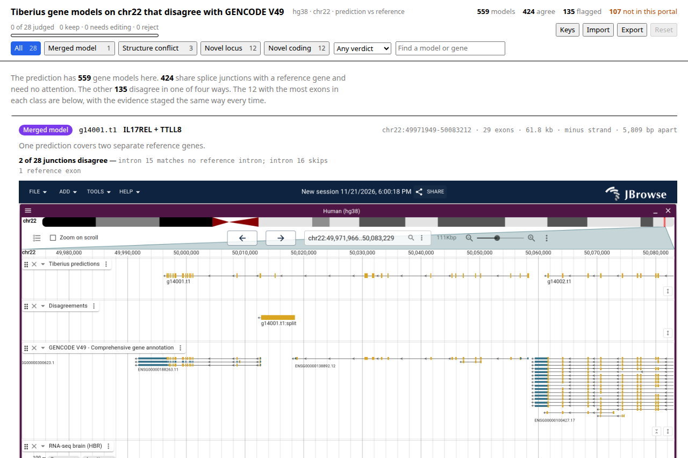
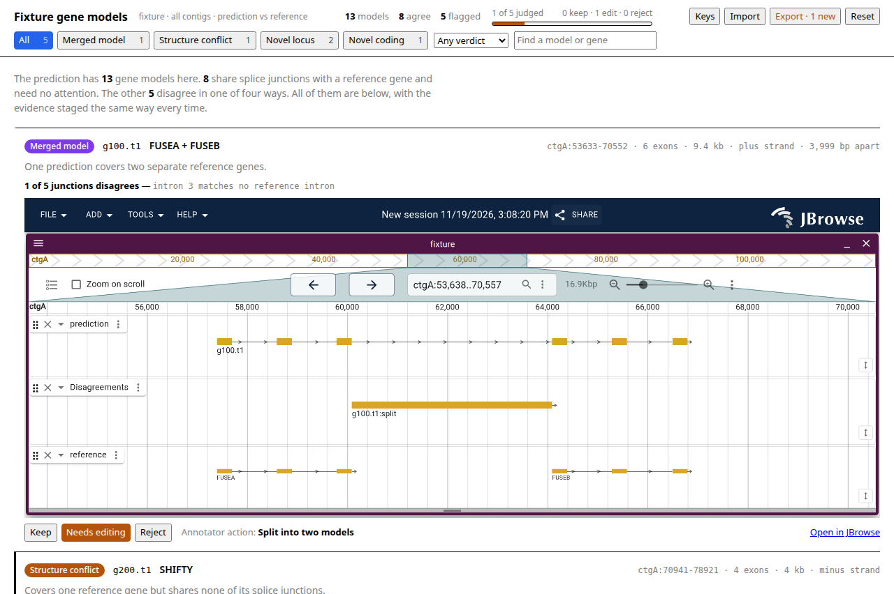

# gene-review-portal

Turn a gene prediction, a reference annotation and a genome into a **static
review portal**: a page of the predicted models that disagree with the
reference, each with a JBrowse screenshot of the locus, a verdict, and a link
that opens the same view live.

A gene finder returns tens of thousands of models and no way to tell which are
wrong. Comparing them against an existing annotation sorts the disagreements
into four kinds, and only those need a person.

```bash
gene-review-portal \
  --prediction tiberius.gff3 \
  --reference gencode.v49.gff3 \
  --fasta GRCh38.fa \
  --rnaseq rnaseq.bam \
  --assembly hg38 --region chr22 \
  --with-app --out ./portal

npx serve ./portal
```

## Install

```bash
git clone https://github.com/cmdcolin/gene-review-portal
cd gene-review-portal
pnpm install
npm link               # gene-review-portal
npm i -g @jbrowse/cli  # jbrowse, for --with-app
```

It also needs `bgzip`, `tabix` and `samtools` on the PATH.
[`@jbrowse/capture`](https://www.npmjs.com/package/@jbrowse/capture) takes the
screenshots; `--no-capture` builds the same page with links and no pictures.

## Gallery

[Tiberius on human chr22](https://jbrowse.org/demos/tiberius_review/), read
against GENCODE 49: a merged model, with the junctions that disagree and the
reference genes it spans.



The test fixture, mid-review: one card judged, the cursor on the next.



## Documentation

- [How a model gets flagged](docs/classification.md): the four classes and
  `conflicts.bed`
- [Reviewing](docs/reviewing.md): keys, your own question, export and import,
  what comes out
- [Evidence and Apollo](docs/evidence-and-apollo.md): `--rnaseq`, and handing a
  flagged model to an annotation editor
- [Flags worth knowing](docs/flags.md): including `--hub` and
  `--reference-track`
- [What this does not do](docs/known-limitations.md): Apollo, link size, memory

[DEVELOPMENT.md](DEVELOPMENT.md) covers tests, screenshots and how the page is
built.

## See also

- [variant-review-portal](https://github.com/cmdcolin/variant-review-portal),
  the same review page for VCF callsets
- [Reviewing a gene prediction (Tiberius)](https://jbrowse.org/jb2/docs/tutorials/gene_prediction_review/),
  the JBrowse tutorial built on this
- [Screenshot a live view](https://jbrowse.org/jb2/docs/jbrowse-capture/), the
  `@jbrowse/capture` that takes the cards' pictures
- [Gene track](https://jbrowse.org/jb2/docs/user_guides/gene_track/) and
  [RNA-seq](https://jbrowse.org/jb2/docs/tutorials/rnaseq/) guides

## License

Apache-2.0. Extracted from
[jbrowse-components](https://github.com/GMOD/jbrowse-components).
